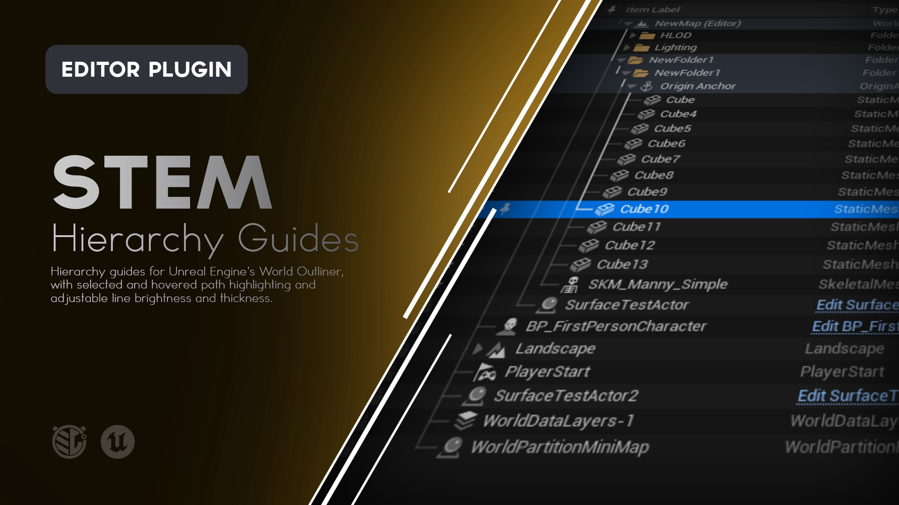
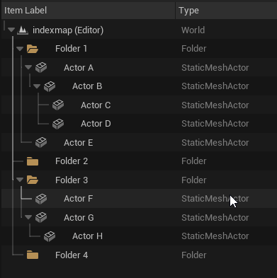
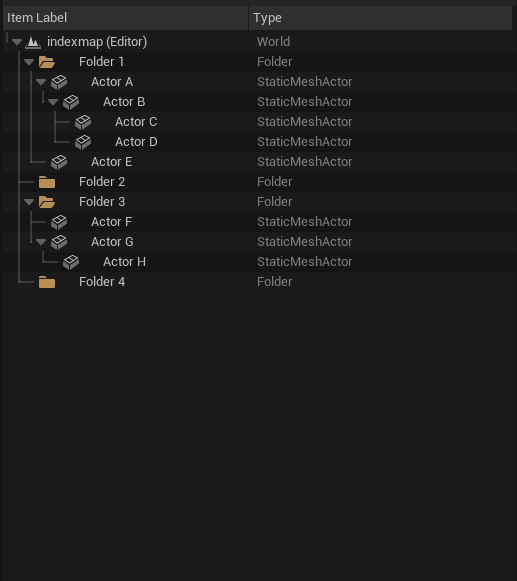
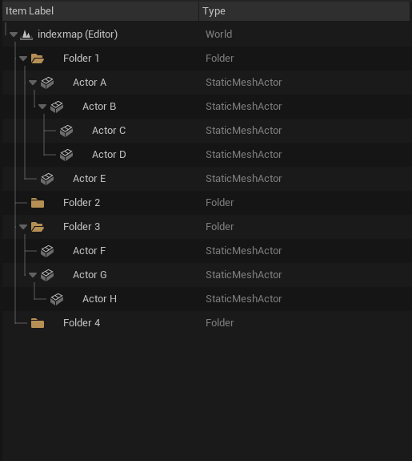

# Stem

### Make Unreal Engine's World Outliner easier to read.

**Clear hierarchy guides. Instantly recognizable parent paths. More room to breathe.**

As projects grow, the World Outliner fills with nested folders, attached Actors, and similarly named objects. Finding which parent a row belongs to—or tracing a selection back through several levels—can become a chore.

**Stem makes those relationships visible at a glance.** It adds subtle connector lines, highlights the paths of selected and hovered rows, and gives you control over row spacing and guide appearance. Everything happens inside Unreal's existing World Outliner, without replacing your workflow or changing your level.

---

## 📖 Full Documentation

**Want to install Stem, customize the guides, understand its behavior, or troubleshoot something?**

### **[Explore the Stem Documentation Website](https://mippi-the-dork.github.io/Stem/)**

The dedicated documentation site includes step-by-step **Design guides**, detailed **Technical references**, illustrated workflows, settings explanations, limitations, and troubleshooting.

| Start here | Learn more |
| --- | --- |
| [Installation & First Use](https://mippi-the-dork.github.io/Stem/?page=01-getting-started%2FREADME.md) | Get Stem running and see the guides in action. |
| [Hierarchy Guides](https://mippi-the-dork.github.io/Stem/?page=02-hierarchy-guides%2FREADME.md) | Understand connector lines, nesting, and expansion. |
| [Path Highlighting](https://mippi-the-dork.github.io/Stem/?page=03-path-highlighting%2FREADME.md) | Follow selections, hover over branches, and inspect shared paths. |
| [Appearance & Settings](https://mippi-the-dork.github.io/Stem/?page=04-appearance-and-settings%2FREADME.md) | Customize row height, guide thickness, and highlight brightness. |
| [Troubleshooting](https://mippi-the-dork.github.io/Stem/?page=05-integration-and-support%2Ftroubleshooting%2FDESIGN.md) | Find answers when the Outliner doesn't look as expected. |
| [Technical Architecture](https://mippi-the-dork.github.io/Stem/?page=05-integration-and-support%2Farchitecture%2FTECHNICAL.md) | Explore the native Slate/SceneOutliner implementation. |

---

## Why Stem?

### See the structure, not just the indentation

In a busy Outliner, whitespace alone isn't always enough to distinguish one branch from another. Stem draws **vertical and horizontal hierarchy guides** beside Unreal's native expansion arrows, helping you follow the parent-child relationships of folders and attached Actors.

The guides adapt to the hierarchy currently displayed, and expanding or collapsing rows still works exactly as it does in Unreal.

**[Learn about hierarchy guides →](https://mippi-the-dork.github.io/Stem/?page=02-hierarchy-guides%2Fcore%2FDESIGN.md)**

### Find your selected Actor's place in the tree

Select a deeply nested Actor or Folder and Stem brightens the visible path leading back through its ancestors. Select multiple Actors and it shows their combined paths—without making shared segments unnaturally bright.

Hover over another row to preview that branch without losing your existing selection. When selected and hovered paths overlap, the stronger configured highlight wins.

*Selected and hovered paths make it easier to trace several branches through the same hierarchy.*

**[Explore path highlighting →](https://mippi-the-dork.github.io/Stem/?page=03-path-highlighting%2FREADME.md)**

### Make dense Outliners more comfortable

Not every hierarchy needs the same visual density. Stem lets you adjust **row height, guide brightness, guide thickness, selected-path brightness, and hovered-path brightness** in **Project Settings → Plugins → Stem**.

Use subtle guides for everyday editing, or make paths more pronounced when you're navigating deeply nested scenes. Row Height can add spacing, but never reduces rows beneath Unreal's native minimum.

| Default row spacing | Increased row spacing |
| :---: | :---: |
|  |  |

*More vertical room improves readability while keeping the same native Outliner controls.*

**[Customize Stem's appearance →](https://mippi-the-dork.github.io/Stem/?page=04-appearance-and-settings%2FREADME.md)**

### Fits into the editor you already use

Stem doesn't ask you to move to a separate hierarchy window. It keeps native labels, icons, expansion arrows, selection, sorting, and drag-and-drop behavior. There is **no extra visible Outliner column** to manage.

Stem is an **Editor-only presentation plugin**. Its hierarchy guides and highlighting don't alter Actor attachments, Folder membership, saved levels, or runtime gameplay.

---

## Getting Started

Stem v1.0.2 targets **Unreal Engine 5.8.x on Windows 64-bit**. The repository records manual testing in Unreal Engine **5.8.2**.

You can install an available compatible release through [GitHub Releases](https://github.com/mippi-the-dork/Stem/releases), use a supported Fab distribution when available, or build the [source](https://github.com/mippi-the-dork/Stem) for your editor.

Once enabled, open a standard World Outliner and expand a nested hierarchy. The guides appear automatically when enabled in Stem's Project Settings.

**[Read the complete installation guide](https://mippi-the-dork.github.io/Stem/?page=01-getting-started%2Finstall%2FDESIGN.md)**

---

## What Stem Does Not Do

Stem is deliberately focused on **World Outliner readability**, not managing or modifying the hierarchy itself.

- It does **not** create, move, rename, attach, or reparent Actors or Folders.
- It does **not** modify level packages or introduce runtime gameplay systems.
- It does **not** replace the World Outliner or add a visible control column.
- It does **not** draw branches that are collapsed or filtered out of the currently displayed Outliner.
- It does **not** guarantee decoration of specialized third-party Outliners, custom expansion widgets, or pinned ancestor duplicates.
- It does **not** guarantee support outside the documented Unreal Engine and platform versions.

If you enable Stem after an Outliner tab is already open, you may need to reopen that tab or restart Unreal Editor to see every guide.

**[Read compatibility and limitations](https://mippi-the-dork.github.io/Stem/?page=05-integration-and-support%2Fcompatibility%2FDESIGN.md)**

---

## Reporting Issues and Requesting Features

Found a bug or have an idea that would make complex hierarchies easier to navigate? Use [GitHub Issues](https://github.com/mippi-the-dork/Stem/issues).

For a bug report, please include the **Stem and Unreal Engine versions**, installation method, what you expected versus what happened, steps to reproduce, and an Outliner screenshot or short recording when useful. Include relevant Output Log entries for technical problems.

For a **feature request**, start with the problem you're trying to solve. That helps keep Stem focused on practical readability improvements instead of adding controls for their own sake.

**[Open an issue or feature request](https://github.com/mippi-the-dork/Stem/issues/new)** · **[Troubleshooting guide](https://mippi-the-dork.github.io/Stem/?page=05-integration-and-support%2Ftroubleshooting%2FDESIGN.md)**

## Contributions

Contributions and pull requests are welcome. For substantial changes, [open an issue](https://github.com/mippi-the-dork/Stem/issues) first to discuss the intended behavior and how it fits Stem's purpose.

Please preserve native World Outliner interactions, avoid modifying Actors or level data, and keep changes compatible with Stem's Editor-only scope. Relevant documentation should be updated alongside behavior changes.

## License

Stem is distributed under the **MIT License**. See [LICENSE](LICENSE).

---

**Stem — a clearer view of the hierarchy you already have.**

[**Documentation**](https://mippi-the-dork.github.io/Stem/) · [**Releases**](https://github.com/mippi-the-dork/Stem/releases) · [**Report an Issue**](https://github.com/mippi-the-dork/Stem/issues) · [**Roadmap**](https://mippi-the-dork.github.io/Stem/?page=ROADMAP.md)
