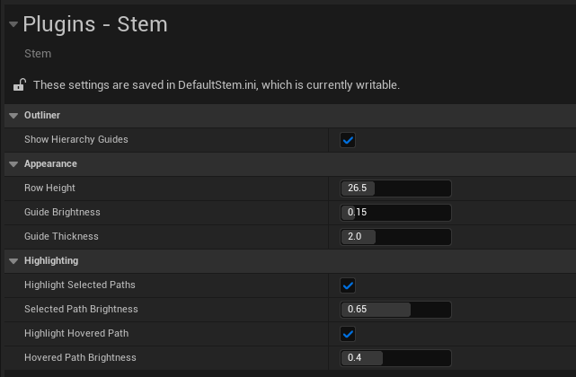

# Stem

**World Outliner Hierarchy Guides for Unreal Engine**

**See how your level fits together, without fighting the Outliner.**

Stem makes complex **World Outliner** hierarchies easier to read. Subtle connector lines reveal the relationships between folders and attached Actors, while selected and hovered path highlighting helps you trace a row back through its visible ancestors. Adjustable row spacing and guide appearance let you make the Outliner comfortable to work in, without replacing Unreal's native tools.

    

  

---

## The World Outliner should be easier to follow

In a large level, nested folders and attached Actors can create a wall of indentation. It's easy to lose track of which row belongs to which parent, especially when several branches are expanded or multiple Actors are selected.

**Stem makes the hierarchy readable at a glance.**

- **Follow the structure.** Connector lines make parent-child relationships easier to trace through the currently displayed folders and Actor attachments.
- **Find your selection.** Selected rows highlight their visible ancestor paths so you can see where they belong.
- **Explore without changing selection.** Hover another row to preview its path while keeping your current selection.
- **Read multiple paths together.** Shared ancestor segments stay consistently bright rather than stacking intensity for every selected Actor.
- **Make space for your workflow.** Adjust row height, guide brightness, thickness and highlight intensity to suit your editor.

  

## Explore the documentation

> ### [**Stem Documentation — Full User Guide and Technical Reference**](https://mippi-the-dork.github.io/Stem/)
>
> **Everything you need to learn and use Stem, in one place.** Learn what the hierarchy guides mean, follow selected and hovered paths, customize the Outliner's appearance, or explore technical implementation details and troubleshooting.
>
> **[Get Started](https://mippi-the-dork.github.io/Stem/?page=01-getting-started%2FREADME.md)** · **[Hierarchy Guides](https://mippi-the-dork.github.io/Stem/?page=02-hierarchy-guides%2FREADME.md)** · **[Path Highlighting](https://mippi-the-dork.github.io/Stem/?page=03-path-highlighting%2FREADME.md)** · **[Appearance & Settings](https://mippi-the-dork.github.io/Stem/?page=04-appearance-and-settings%2FREADME.md)**

The README is a quick introduction to why Stem is useful. **The [documentation website](https://mippi-the-dork.github.io/Stem/) is the maintained reference for setup, exact behavior, settings, compatibility, and technical details.**

## Clearer hierarchies. Same native Outliner.

Stem focuses on the parts of the Outliner that help you understand where things belong.

| Feature | What it gives you |
| --- | --- |
| **[Hierarchy Guides](https://mippi-the-dork.github.io/Stem/?page=02-hierarchy-guides%2Fcore%2FDESIGN.md)** | Subtle vertical and horizontal connectors between displayed folders and attached Actors. |
| **[Native Expansion](https://mippi-the-dork.github.io/Stem/?page=02-hierarchy-guides%2Fexpansion%2FDESIGN.md)** | Standard expand/collapse controls, with connectors following the currently visible tree. |
| **[Selected Path Highlighting](https://mippi-the-dork.github.io/Stem/?page=03-path-highlighting%2Fselected%2FDESIGN.md)** | Brighter guides leading from selected rows through their displayed ancestors. |
| **[Hovered Path Highlighting](https://mippi-the-dork.github.io/Stem/?page=03-path-highlighting%2Fhovered%2FDESIGN.md)** | A temporary path preview without changing what you've selected. |
| **[Combined Paths](https://mippi-the-dork.github.io/Stem/?page=03-path-highlighting%2Fcombined%2FDESIGN.md)** | Multiple highlighted branches, with shared segments using the strongest relevant brightness rather than adding together. |
| **[Row Height](https://mippi-the-dork.github.io/Stem/?page=04-appearance-and-settings%2Frow-height%2FDESIGN.md)** | More vertical space between rows without losing native Outliner labels or controls. |
| **[Appearance Controls](https://mippi-the-dork.github.io/Stem/?page=04-appearance-and-settings%2Fguide-appearance%2FDESIGN.md)** | Configurable guide visibility, brightness, thickness, and independent selected/hovered highlighting. |

All settings live under **Project Settings → Plugins → Stem**. Stem does not add a separate hierarchy editor or a visible extra Outliner column.

## Useful in real production workflows

### Trace deeply nested Actors

When a scene has several levels of folders and attachments, follow Stem's connectors to understand which visible branch an Actor belongs to. Expand or collapse as you normally would; the guides follow Unreal's displayed hierarchy.

[**Understand the hierarchy guides →**](https://mippi-the-dork.github.io/Stem/?page=02-hierarchy-guides%2FREADME.md)

### Keep track of selections while exploring

Select a deeply nested Actor and see its highlighted path through visible ancestors. Hover other rows to preview their paths without changing selection. When you select several Actors, Stem displays their combined paths with consistent brightness on shared segments.

  

[**Explore selected, hovered and combined paths →**](https://mippi-the-dork.github.io/Stem/?page=03-path-highlighting%2FREADME.md)

### Give dense scenes more breathing room

Increase row height to make a crowded Outliner easier to scan. Adjust guide brightness and thickness separately so the hierarchy is visible without overwhelming the Actor labels.

  
  

Row Height adds space when requested, but does not shrink native rows below Unreal's minimum height.

[**Customize Stem's appearance →**](https://mippi-the-dork.github.io/Stem/?page=04-appearance-and-settings%2FREADME.md)

## Get Stem

**Stem v1.0.2** targets **Unreal Engine 5.8.x on Windows 64-bit** and runs in the **Editor only**. The repository reports manual testing in **Unreal Engine 5.8.2**.

Install a compatible prebuilt release when available, use a supported Fab distribution if you have access to one, or build the full source from this repository. Once enabled, open a standard World Outliner and expand a hierarchy to see Stem's guides.

**[Download GitHub Releases](https://github.com/mippi-the-dork/Stem/releases)** · **[Installation Guide](https://mippi-the-dork.github.io/Stem/?page=01-getting-started%2Finstall%2FDESIGN.md)** · **[First Use](https://mippi-the-dork.github.io/Stem/?page=01-getting-started%2Ffirst-use%2FDESIGN.md)**

## Important limitations

Stem is an **editor presentation utility**, not a new hierarchy system or a level-editing tool.

- **Displayed rows only.** Guides and highlights operate on the tree shown in the Outliner. Collapsed branches and filtered-out rows do not contribute visible segments.
- **Standard World Outliner focus.** Specialized Outliners, custom expanders, and pinned ancestor duplicates may not receive normal guide or hover behavior.
- **No hierarchy edits.** Stem does not create, rename, move, attach, detach, or reparent Actors or Folders, or modify level packages.
- **Native behavior stays native.** Stem preserves Unreal's normal selection, expansion, sorting, labels, and drag-and-drop rather than replacing them.
- **Row height has a floor.** It cannot force rows below Unreal's native minimum height.
- **No packaged-game runtime.** There is no Stem gameplay module, Actor, or runtime hierarchy component.
- **Existing tabs may need refreshing.** If Stem is enabled after an Outliner tab is already open, reopen that tab or restart the editor to see guides.

For details, see [Compatibility and Limitations](https://mippi-the-dork.github.io/Stem/?page=05-integration-and-support%2Fcompatibility%2FDESIGN.md) and [Troubleshooting](https://mippi-the-dork.github.io/Stem/?page=05-integration-and-support%2Ftroubleshooting%2FDESIGN.md).

## What's next?

Stem v1.0.2 already provides hierarchy guides, path highlighting, and appearance controls. Potential future areas to evaluate include compatibility with more Outliner layouts, accessibility and visibility improvements, and editor performance testing on larger displayed trees.

These are **areas to investigate, not announced features or a committed release schedule**.

[**View the Stem Roadmap →**](https://mippi-the-dork.github.io/Stem/?page=ROADMAP.md)

## Issues, feature requests and contributions

Found a problem? Please [open an issue](https://github.com/mippi-the-dork/Stem/issues) with your Stem and Unreal Engine versions, installation method, affected Outliner type, steps to reproduce, and a screenshot, video, or Output Log excerpt when useful.

Have an idea? [Submit a feature request](https://github.com/mippi-the-dork/Stem/issues) describing the hierarchy-readability problem you want solved and the outcome you'd like to achieve.

**Pull requests are welcome.** For larger changes, open an issue first so the intended scope can be discussed. Stem aims to remain lightweight and compatible with Unreal's existing Outliner workflow.

## License

Stem is distributed under the **MIT License**. See [LICENSE](LICENSE) for the full terms.

---

**Stem is created by Mippi the Dork.**

**[Explore the Documentation](https://mippi-the-dork.github.io/Stem/)** · **[Get Stem](https://github.com/mippi-the-dork/Stem/releases)** · **[Report an Issue](https://github.com/mippi-the-dork/Stem/issues)**
