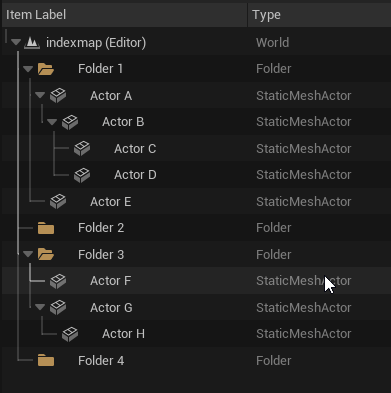

# First Use — Design

**Stem v1.0.2 · Unreal Engine 5.8.x · Editor only**

## A quick exercise

1. Open any disposable level with a nested folder or Actor attachment hierarchy.
2. Expand two or three levels of the standard World Outliner.
3. Find the connector guides beside Unreal's existing expansion triangles.
4. Select a child Actor. Follow its brighter guide segments upward toward visible ancestors.
5. Hover a different child Actor. Notice the temporary hover path without changing selection.
6. Select two descendants from different branches to see their combined highlighted paths.
7. Open **Project Settings → Plugins → Stem** and change Row Height, Guide Brightness or Guide Thickness. Observe the Outliner immediately.

<figure class="doc-media" data-kind="gif" data-media-id="first-use-highlights">
  
  <figcaption>Selected and hovered hierarchy paths remain visually distinct while navigating the Outliner.<strong>Capture instructions · GIF:</strong> Record an expanded hierarchy, select a deeply nested Actor, hover a different Actor, then select two descendants from different branches. Keep the native expansion controls and path highlights visible.</figcaption>
</figure>

## How to read the lines

Normal guides are subtle, with brightness set by **Guide Brightness**. Selected paths use **Selected Path Brightness**; hovered paths use **Hovered Path Brightness**. The stronger value wins when a segment belongs to both paths. Changing brightness does not change Actor selection or their hierarchy.

## Important expectations

Stem only draws relationships that the Outliner is **currently displaying**. Collapsed and filtered-out portions of a hierarchy aren't rendered. Existing pinned ancestor duplicates are not normal hover targets. The plugin leaves normal Unreal expansion, selection, sorting and drag/drop behavior intact.

## Try one setting at a time

For a dense scene, start by increasing Row Height slightly. Then adjust Guide Brightness until it is visible but not distracting. If hover feedback is difficult to distinguish from selection, adjust their independent brightness values rather than changing the level.

Next: [Hierarchy Guides](../../02-hierarchy-guides/core/DESIGN.md).

---

[Technical implementation](TECHNICAL.md) · [Getting Started overview](../README.md)
