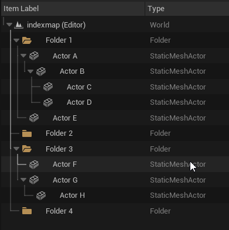

# Multiple Selection and Combined Paths — Design

**Stem v1.0.2 · Unreal Engine 5.8.x · Editor only**

## Understand shared ancestry

Select two child Actors that share an ancestor, such as **Interior → Chair** and **Exterior → Door** under the same Building. Stem highlights both paths. Their common Building ancestor path is brightened only once.

<figure class="doc-media" data-kind="gif" data-media-id="combined-paths"><figcaption>Shared ancestor guides remain consistently bright when multiple rows are selected and another row is hovered.<strong>Capture instructions · GIF:</strong> Record Ctrl-selecting two children in different branches, hovering a third row, and moving away. Show shared parent segments remain the same brightness without flashing or intensifying per selection.</figcaption></figure>

## Selection and hover together

A selected Actor can remain highlighted while you hover a different Actor. If those paths overlap, Stem uses the stronger of Selected Path Brightness and Hovered Path Brightness at that segment. It never adds the two values together.

## Useful combinations

For environment review, multi-select Actors in two wings of a building and see their shared parent. While leaving them selected, hover through a third room to inspect that branch.

## Why it may look subtle

If Selected Path Brightness, Hovered Path Brightness and Guide Brightness are similar, the visible distinction is small. Increase the values deliberately instead of trying to select more Actors to force a brighter shared segment.

## Availability

Paths are calculated from currently displayed rows, not unloaded Actors or hidden children. Filtering and collapsing a branch change what can be drawn.

---

[Technical details](TECHNICAL.md) · [Path Highlighting overview](../README.md)
