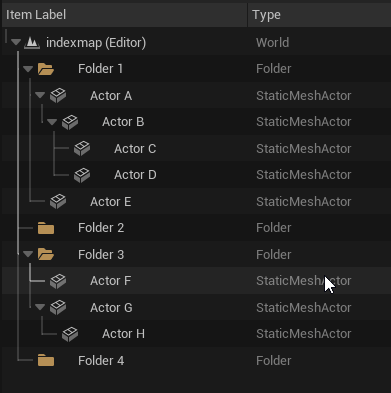

# Hovered Path Highlighting — Design

**Stem v1.0.2 · Unreal Engine 5.8.x · Editor only**

## Inspect a branch without selecting it

Move the pointer over an ordinary displayed Outliner row. Stem can brighten the guide path from that row through its visible ancestors. Move away and the temporary hover emphasis disappears.

<figure class="doc-media" data-kind="gif" data-media-id="hovered-path"><figcaption>Hovering different Outliner rows previews their hierarchy paths without changing the selected Actor.<strong>Capture instructions · GIF:</strong> Record one Actor selected, then sweep the cursor across two other branches, pausing long enough for hover path highlighting to appear and disappear. Keep selection unchanged.</figcaption></figure>

## Configuration

Open **Project Settings → Plugins → Stem**. Turn on **Highlight Hovered Path** (default On). Set **Hovered Path Brightness** (default **0.40**) sufficiently above Guide Brightness (default **0.15**) to make the path readable.

## If hovering appears to do nothing

Check whether Show Hierarchy Guides or Highlight Hovered Path is off, whether the branch is expanded, and whether the hovered widget is a normal supported row. Pinned ancestor duplicates and specialized custom Outliner rows are outside guaranteed hover support.

## Selection remains active

A selected path can stay bright while another path is previewed through hover. On overlapping segments, Stem uses whichever configured brightness is greater, not additive blending. This makes the two interactions complementary.

---

[Technical details](TECHNICAL.md) · [Path Highlighting overview](../README.md)
