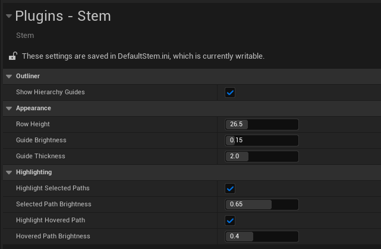

# Project Settings and Persistence — Design

**Stem v1.0.2 · Unreal Engine 5.8.x · Editor only**

## Where the settings live

Open **Project Settings → Plugins → Stem**. You will find **Outliner**, **Appearance** and **Highlighting** categories covering guide visibility, row height, guide brightness and thickness, and selected/hovered path behavior.

<figure class="doc-media" data-kind="image" data-media-id="project-settings-overview"><figcaption>All Stem preferences are available in Unreal Engine's Project Settings under Plugins → Stem.<strong>Capture instructions · Image:</strong> Capture the Stem Project Settings page in Unreal with Outliner, Appearance and Highlighting groups expanded so all eight controls and their current values are visible.</figcaption></figure>

## Defaults at a glance

| Setting | Default |
| --- | ---: |
| Show Hierarchy Guides | On |
| Row Height | 26.5 |
| Guide Brightness | 0.15 |
| Guide Thickness | 2.0 |
| Highlight Selected Paths | On |
| Selected Path Brightness | 0.65 |
| Highlight Hovered Path | On |
| Hovered Path Brightness | 0.40 |

## What saves?

Stem uses project configuration. Depending on your project and source-control workflow, configuration changes can be shared as ordinary project settings. **It does not save Stem metadata on Actors, Folders or levels.** No manual level-save operation is needed to make a setting part of the project configuration.

## Settings versus scene actions

Changing Row Height cannot reparent an Actor. Turning off guides does not delete hierarchy data. Selected and hovered highlights are momentary editor display states rather than stored selection bookmarks.

## Resetting

To restore the shipped look, use the default values above in Project Settings. Do not delete unrelated project configuration or level assets.

---

[Technical details](TECHNICAL.md) · [Appearance and Settings overview](../README.md)
