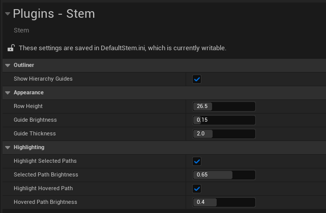

# Highlight Preferences — Design

**Stem v1.0.2 · Unreal Engine 5.8.x · Editor only**

## Available preferences

| Setting | Default | Meaning |
| --- | ---: | --- |
| Highlight Selected Paths | On | Brighten the paths of selected rows |
| Selected Path Brightness | 0.65 | Desired selected highlight brightness, 0–1 |
| Highlight Hovered Path | On | Brighten the path beneath the cursor |
| Hovered Path Brightness | 0.40 | Desired hovered highlight brightness, 0–1 |

Settings live at **Project Settings → Plugins → Stem**. The brightness fields are enabled only when their corresponding highlight option is on.

<figure class="doc-media" data-kind="image" data-media-id="highlight-settings-panel"><figcaption>Selected and hovered hierarchy highlights have independent enable switches and brightness controls.<strong>Capture instructions · Image:</strong> Capture the Stem Project Settings Highlighting section with both checkboxes enabled and default values 0.65 and 0.40 visible; show relevant surrounding settings for context.</figcaption></figure>

## How to tune them

Start with Guide Brightness **0.15**, Selected Path Brightness **0.65** and Hovered Path Brightness **0.40**. Lower hover brightness if the pointer path competes with your active selection. Raise selected brightness if it is hard to trace through a deep tree.

## Overlapping paths

Shared selected paths do not accumulate brightness. If hover and selection overlap, the stronger configured brightness wins. A highlight won't make a normal guide darker than its base brightness.

## If your setting doesn't seem to apply

Make sure Show Hierarchy Guides is enabled. Check that the ancestor rows are actually displayed and the relevant highlighting checkbox is on. If every brightness value is close together, adjust their separation.

---

[Technical details](TECHNICAL.md) · [Appearance and Settings overview](../README.md)
