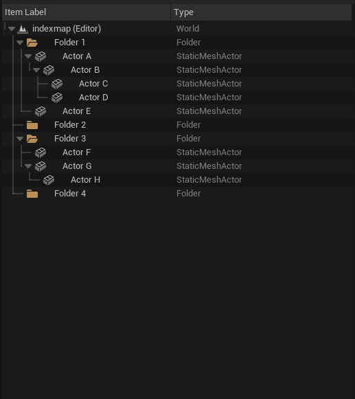
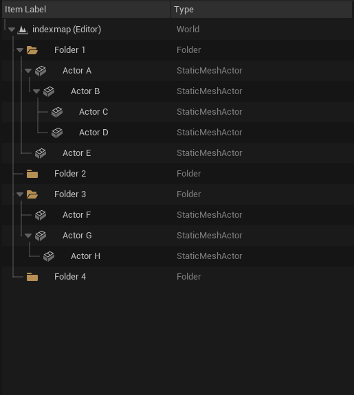

# Row Height and Spacing — Design

**Stem v1.0.2 · Unreal Engine 5.8.x · Editor only**

## Why change row height?

Dense hierarchies can feel crowded. A little more spacing makes connector lines, folder names, selection highlights and expansion controls easier to scan.

<figure class="doc-media" data-kind="image" data-media-id="row-height-comparison">
  
  
  <figcaption>Row Height increases vertical spacing without replacing the native Outliner rows.<strong>Capture instructions · Image:</strong> Use two captures of the same Outliner rows at default 26.5 and a clearly larger Row Height, with identical folder expansion and row labels; crop consistently for a fair comparison.</figcaption>
</figure>

## Adjusting the value

Open **Project Settings → Plugins → Stem → Row Height**. Default: **26.5 pixels**. The property is clamped to **20–64**, with UI slider range **20–40**.

Increasing Row Height refreshes open registered standard Outliners. Stem never forces an effective row height below Unreal's own native minimum.

## Troubleshooting

**The row seems unchanged at a small number.** Unreal's native minimum may already be higher than the requested value. Try a visibly larger number.

**The label shifted briefly after expanding a folder.** Stem measures custom expansion widgets before insertion to avoid a transient zero-width layout. If you see shifts, record the exact engine version and reproduction.

**Can I use this in a special Outliner?** Stem targets standard World Outliners; custom layouts aren't guaranteed.

## Scope and save

This is a **project configuration** change, not a per-Actor value. It does not change level package data or packaged gameplay.

---

[Technical details](TECHNICAL.md) · [Appearance and Settings overview](../README.md)
